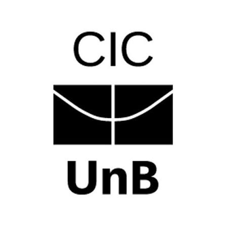

# Sistema RAG com LLM Local para Consulta à Wikipédia


<p align="center">
  
</p>

> Projeto acadêmico que implementa um sistema de Retrieval-Augmented Generation (RAG) para responder perguntas com base em passagens da Wikipédia. O sistema combina busca híbrida — semântica e por palavras-chave — com um modelo de linguagem executado localmente, apresentando as fontes recuperadas.

## Ajustes e melhorias

O projeto está em desenvolvimento. Entre as próximas melhorias estão:

- [x] Busca híbrida com BM25 e embeddings semânticos
- [x] Geração local de respostas com o modelo SmolLM2
- [x] Exibição das fontes recuperadas e citações
- [x] Ferramentas de avaliação e benchmarking
- [ ] Ampliar e melhorar a cobertura do corpus
- [ ] Aprimorar a extração e a validação de citações
- [ ] Expandir os testes e a avaliação das respostas

## 💻 Pré-requisitos

Antes de começar, verifique se você tem:

- Python 3.12.
- Windows 11, sistema usado nos testes do projeto. Linux e macOS podem funcionar, mas não foram validados.
- Conexão com a internet na primeira execução, para baixar os dados e os modelos do Hugging Face.
- Espaço em disco e memória suficientes para os dados, o índice e o modelo local. A necessidade varia conforme o tamanho do corpus.
- Familiaridade básica com terminal e ambientes virtuais Python.

## 🚀 Instalando

Abra um terminal na pasta do projeto e crie um ambiente virtual.

### Windows (PowerShell)

```powershell
cd busca
py -3.12 -m venv .venv
.\.venv\Scripts\Activate.ps1
python -m pip install --upgrade pip
python -m pip install -r requirements.txt
```

### Linux e macOS

```bash
cd busca
python3.12 -m venv .venv
source .venv/bin/activate
python -m pip install --upgrade pip
python -m pip install -r requirements.txt
```

Na primeira execução, o programa pode baixar as passagens da Wikipédia e os modelos necessários. Esse processo pode levar alguns minutos.

## ☕ Usando

Execute os comandos a partir da pasta `busca`.

### Fazer uma pergunta

```bash
python consultar.py -p "What is the capital of France?"
```

### Iniciar o modo interativo

```bash
python consultar.py
```

Digite as perguntas em inglês. Para encerrar, envie uma linha vazia ou digite `sair`.

### Consultar sem gerar resposta

Este modo executa a recuperação e mostra as passagens encontradas, sem chamar o LLM:

```bash
python consultar.py -p "What is the capital of France?" --sem-llm
```

### Mostrar o conteúdo das passagens recuperadas

```bash
python consultar.py -p "What is the capital of France?" --trechos
```

### Opções principais

| Opção | Descrição | Padrão |
|---|---|---:|
| `-p`, `--pergunta` | Faz uma pergunta única e encerra | — |
| `--n` | Número de passagens indexadas | `5000` |
| `--k` | Número de trechos recuperados por pergunta | `3` |
| `--semente` | Semente usada na amostragem do corpus | `42` |
| `--shards` | Número de arquivos Parquet usados como fonte | `1` |
| `--llm` | Identificador do modelo de geração | SmolLM2-1.7B-Instruct |
| `--sem-llm` | Recupera trechos sem gerar resposta | — |
| `--max-tokens` | Limite de tokens da resposta | `200` |
| `--trechos` | Exibe o texto dos trechos recuperados | — |

Exemplo com mais passagens:

```bash
python consultar.py --n 20000 --k 5 -p "What is the capital of France?"
```

## 🧪 Avaliação e testes

Para executar a avaliação sem as métricas do RAGAS:

```bash
python avaliar.py --q 30 --sem-ragas
```

Para executar os testes dos coletores de dados, a partir da raiz do projeto:

```powershell
py -3.12 -m unittest discover -s dados -p "test_coletar*.py" -v
```

## 📚 Documentação

- [Documentação técnica](Documentacao.md)
- [Coleta de dados](dados/README.md)

## 📫 Contribuindo

Contribuições são bem-vindas. Para colaborar:

1. Faça um fork deste repositório.
2. Crie uma branch: `git checkout -b minha-contribuicao`.
3. Faça as alterações e crie um commit: `git commit -m "Descreve a alteração"`.
4. Envie a branch: `git push origin minha-contribuicao`.
5. Abra um pull request.

Consulte também a documentação do GitHub sobre [como criar um pull request](https://docs.github.com/pt/pull-requests/collaborating-with-pull-requests/proposing-changes-to-your-work-with-pull-requests/creating-a-pull-request).

## 🤝 Integrantes

| Integrante | Matrícula |
|---|---:|
| Esthefany Torres | 212005382 |
| João Felipe Silva | 202014388 |
| Pedro Rafael Faria Ferreira | 190094591 |
| Rafael de Jesus Bento Oliveira | 190115777 |
| Mauro Fernandes de Almeida | 211020910 |

## 📝 Licença

A licença deste projeto ainda não está definida. As bibliotecas e os conjuntos de dados utilizados podem ter licenças e condições de uso próprias; consulte os respectivos termos antes de redistribuí-los ou reutilizá-los.
